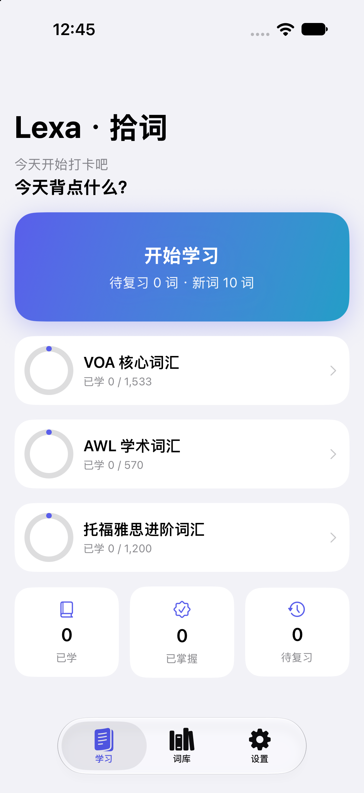
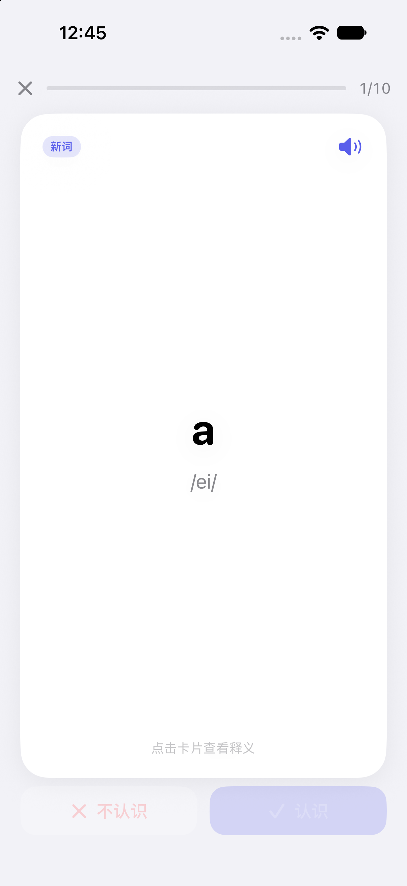
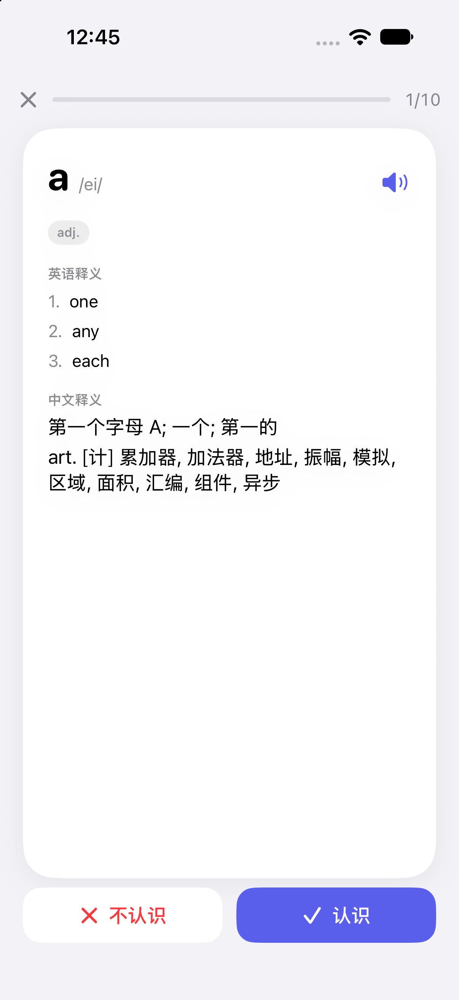
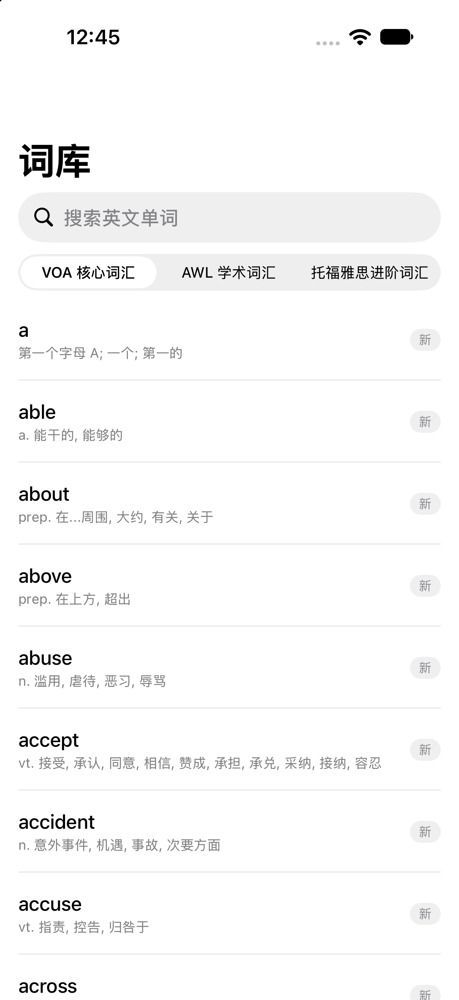
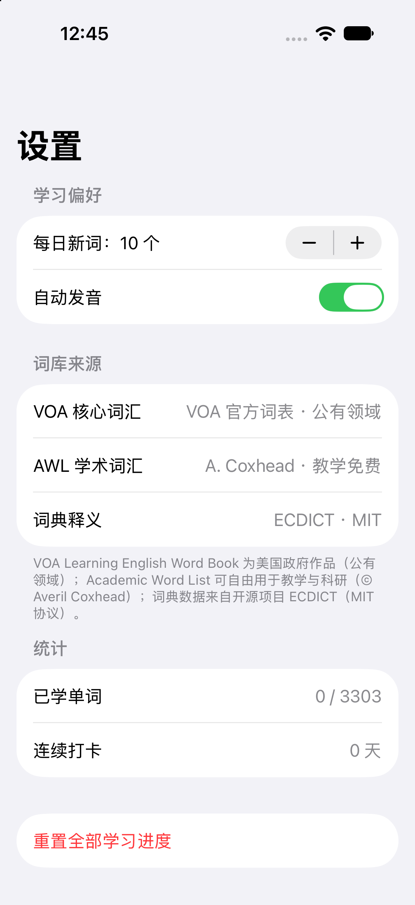

# Lexa · 拾词 📚

一款面向非母语者的 iOS 背单词 App。词库取自**美国官方/权威学术材料**，配合间隔重复（SRS）算法和系统级英文发音，帮助学习者高效记忆英语单词。

> SwiftUI 构建，零第三方依赖，支持 iOS 17+。共 **3,303 词**：VOA 核心词汇 1,533 + AWL 学术词汇 570 + 托福雅思进阶 1,200。

| 首页 | 学习卡片 | 翻面释义 |
|---|---|---|
|  |  |  |

| 词库浏览 | 设置（含来源声明） |
|---|---|
|  |  |

## 功能

- **卡片式学习**：点击卡片翻面查看释义，"认识 / 不认识"一键反馈
- **间隔重复调度**：Leitner 盒子算法（答对进阶、答错回退），复习间隔 10 分钟 → 1/2/4/8/16/32 天递增
- **发音**：系统 TTS 美音朗读，出卡自动发音可开关
- **三本权威词书**：见下方"词库来源"
- **词库浏览**：按词书切换、英文搜索、学习状态标记（新词 / 学习中 / 已掌握）
- **学习统计**：每日新词数可调（5–100）、连续打卡、已学 / 已掌握 / 待复习统计
- **本地持久化**：学习进度、偏好全部保存在本地，无需注册登录

## 词库来源

| 词书 | 来源 | 授权 |
|---|---|---|
| VOA 核心词汇（1,533 词） | [VOA Learning English Word Book](https://learningenglish.voanews.com/a/voa-word-book/6607229.html)（美国国际媒体署 USAGM 旗下"美国之音"官方教学词表，释义取自官方 PDF） | 美国政府作品，公有领域 |
| AWL 学术词汇（570 词） | Academic Word List（Averil Coxhead 制作，北美及英语世界大学 ESL/EAP 教学广泛使用的 570 学术词族） | 可自由用于教学与科研（© Averil Coxhead，需署名） |
| 释义 / 音标 / 中文 | [ECDICT](https://github.com/skywind3000/ECDICT) 开源英汉词典 | MIT License |

抓取与加工过程详见 [`data-pipeline/SOURCES.md`](data-pipeline/SOURCES.md)，复现脚本见 [`data-pipeline/build_vocab.py`](data-pipeline/build_vocab.py)（成品 JSON 已打包在 `Lexa/Resources/`，无需重新抓取）。

## 项目结构

```
lexa/
├── Lexa.xcodeproj
├── data-pipeline/         # 词库抓取/加工脚本与来源说明（不参与 App 构建）
└── Lexa/
    ├── LexaApp.swift      # App 入口（支持 --screen 参数直达界面，便于自动化验证）
    ├── Models.swift       # 数据模型
    ├── Store.swift        # 词库加载、SRS 调度、持久化、TTS
    ├── ContentView.swift  # 根 TabView
    ├── HomeView.swift     # 首页：开始学习、词书进度、统计
    ├── StudyView.swift    # 学习流：卡片翻面、发音、认识/不认识
    ├── BrowseView.swift   # 词库浏览与单词详情
    ├── SettingsView.swift # 设置：每日新词数、发音开关、来源声明、重置
    └── Resources/         # 三本词书 JSON（构建期打包进 App）
```

## 本地运行

```bash
open Lexa.xcodeproj   # Xcode 中直接 Cmd+R
```

或命令行：

```bash
xcodebuild -project Lexa.xcodeproj -scheme Lexa \
  -destination 'platform=iOS Simulator,name=iPhone 18 Pro' build
```

自动化验证参数：`--screen study|browse|settings` 直达对应界面，`--revealed` 翻开首张卡片，`--demo-answer` 自动答 3 题（用于验证调度与持久化链路）。

## 许可证 License

**代码：MIT**，见 [LICENSE](LICENSE)。**随 App 打包的词库保留各自来源的授权**，见上面“词库来源”表：VOA 词表是美国政府作品（公有领域），AWL 学术词汇需署名（© Averil Coxhead），释义和音标来自 [ECDICT](https://github.com/skywind3000/ECDICT)（MIT）。再分发词库时请一并保留这些署名和授权说明。

The code is released under the **MIT License** (see [LICENSE](LICENSE)). The word lists bundled with the app keep the licenses of their sources, listed in the table above (VOA word book: US government work, public domain; Academic Word List: attribution to Averil Coxhead required; definitions and phonetics: ECDICT, MIT). Keep those notices if you redistribute the word lists.

## 隐私政策 Privacy Policy

拾词 Lexa 不收集任何用户数据。

- 不收集、不存储、不上传任何个人信息、使用数据或设备信息；
- 所有学习进度与偏好设置仅保存在设备本地；
- 无广告、无统计分析 SDK、无需注册登录。

Lexa does not collect any data. All learning progress and preferences are stored locally on your device only. The app contains no ads, no analytics SDKs, and requires no account.

## 数据删除 Data Deletion

拾词没有账号体系，也不上传任何数据，因此无需"删除账户"流程：

- 卸载应用即彻底删除全部本地学习数据；
- 也可以在应用内 设置 → 重置全部学习进度，一键清空记录但保留应用。

Lexa has no accounts and no server-side data, so there is no account-deletion flow: uninstalling the app permanently erases all local study data, or you can reset your progress in Settings without removing the app.

## Roadmap

- [ ] 例句（来自 VOA Learning English 新闻语料）
- [ ] 拼写练习模式
- [ ] iCloud 同步学习进度
- [ ] USCIS 入籍公民词汇（美国官方移民局材料）
- [ ] App 图标与 TestFlight 发布
